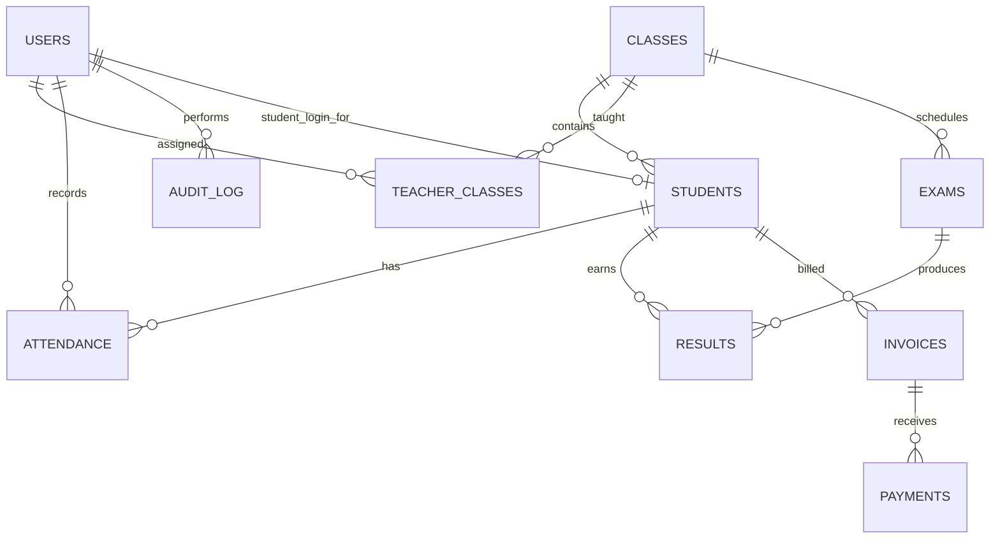

# SchoolDesk

SchoolDesk is a responsive school operations MVP built with React, Node.js, Express, and MySQL. It demonstrates the key school journeys from the assessment brief with synthetic records and role-aware server-side access control.

## What works

- Role-based sign-in for administrator, teacher, and student accounts.
- Student directory with admin student creation, role-scoped records, and search.
- Daily attendance recording. A database uniqueness constraint prevents a second entry for the same student, date, and session.
- Exam results with server-calculated grades and class checks.
- Student-scoped report cards, attendance, and fee records.
- Fee invoices, simulated payments, and transactional balance checks.
- Dashboard summaries, audit records, and responsive loading, empty, success, and error states.

Class, teacher, and subject setup screens, student account provisioning, recurring invoice generation, richer report filters, and a hosted demo are not included yet.

## Architecture

```text
React (Vite) ── same-origin /api ── Express API ── mysql2 pool ── MySQL
                                         │
                                         ├── session authentication
                                         ├── server-side role and class checks
                                         └── business rules + audit trail
```

The UI is in `src/`. The API and database bootstrap are in `server/`. MySQL schema definitions are repeatable in `server/schema.mysql.sql`; `server/db.js` applies the schema and seeds demo records only when the users table is empty. When `DB_HOST` is unset, the app uses SQLite for isolated tests. Authorization is enforced in API middleware and handlers rather than relying on hidden UI controls.

### Data model



Important integrity rules include unique student admission numbers, unique teacher/class assignments, a unique attendance tuple `(student_id, attendance_date, session)`, unique exam/student results, positive invoice/payment amounts, and foreign keys. Fee payments run in a transaction and cannot exceed the remaining invoice balance.

## Local setup

Requirements: Node.js 18 or newer, npm, and a local MySQL server.

```bash
npm install
cp .env.example .env
# Set DB_PASSWORD in .env to your actual MySQL password.
npm run server         # terminal 1, API on http://localhost:3000
npm run dev            # terminal 2, Vite on http://localhost:5173
```

Open `http://localhost:5173`. The Vite development server proxies `/api` to the Node server. To create a production build and serve it from Express:

```bash
npm run build
npm start
```

The app creates `DB_NAME` if it does not exist, so the MySQL account needs permission to create a database. Otherwise create it once with `CREATE DATABASE my_backend CHARACTER SET utf8mb4 COLLATE utf8mb4_unicode_ci;` and grant the configured account access. On startup, existing guardian-role accounts are migrated to student-role accounts while retaining their linked student records. `SMS_DEMO_PASSWORD` changes the seeded demo password on the first initialization. Set a unique `SESSION_SECRET` and `NODE_ENV=production` before exposing the app outside localhost. Never commit `.env` or put real student data or payment credentials in the demo database.

## Demo accounts

All accounts use `school123` by default.

| Role | Email | Scope |
| --- | --- | --- |
| Administrator | `admin@school.test` | All seeded school records; can record payments |
| Teacher | `teacher@school.test` | Grade 8 sections A and B; can record attendance and results |
| Student | `student@school.test` | Aarav Sharma only |
| Student | `student2@school.test` | Ananya Iyer only |

The data is synthetic. Seed records include a Grade 8 Mathematics assessment and a partially paid tuition invoice.

## API reference

All API routes use JSON. Authenticated routes use an HTTP-only, same-site session cookie. Errors use `{ "error": "..." }` and suitable HTTP status codes.

| Method and route | Access | Purpose |
| --- | --- | --- |
| `POST /api/auth/login` | Public | Start a session with `{email,password}` |
| `POST /api/auth/logout` | Public | End the current session |
| `GET /api/auth/me` | Signed in | Return the current role and identity |
| `GET /api/dashboard` | Signed in | Role-scoped totals and recent activity |
| `GET /api/students?q=&page=&limit=` | Signed in | Search and paginate visible students |
| `GET /api/classes` | Admin | List classes for student creation |
| `POST /api/students` | Admin | Create `{name,admission_no,class_id,guardian_name,email}` |
| `GET /api/attendance` | Signed in | Visible attendance records |
| `POST /api/attendance` | Admin, teacher | `{student_id,date,session,status}` for authorized classes |
| `POST /api/attendance` | Student | Self check-in; API always records the linked student as Present for today and rejects duplicates |
| `GET /api/exams` | Signed in | Visible exams and permitted results |
| `POST /api/results` | Admin, teacher | `{exam_id,student_id,marks}`; upserts grade |
| `GET /api/fees` | Signed in | Visible invoices with paid and due cents |
| `POST /api/fees/:id/payments` | Admin | `{amount}` in rupees; simulated payment only |
| `GET /api/report-card?student_id=` | Signed in | Report card; students are restricted to their linked record |

## Rules and grade bands

Scores below the exam pass mark receive `Needs support`. Passing scores receive A at 90%+, B at 80%+, C at 70%+, D at 60%+, and E below 60%. Result entry rejects marks outside `0..max_marks`, students outside the exam class, and classes outside a teacher’s assignments. A result can be corrected by re-submitting the same exam/student pair.

Attendance duplicates return HTTP 409. Payments run inside a transaction, reject amounts above the current balance, and create synthetic references. The dashboard and fee API derive paid and due totals from the payment ledger.

## Tests

```bash
npm test
```

Integration tests use a temporary SQLite database and a local HTTP server, so they do not require MySQL. They cover teacher scope, staff and student attendance conflicts, grade calculation, student privacy, and fee balance reconciliation. Configure `.env` before running the app to connect it to MySQL.

## Known limitations

- Authentication uses an in-memory Express session store, suitable for local demonstration but not a multi-instance production deployment.
- No password reset, invite flow, production deployment, live payment integration, or real personal data is included.
- The grading bands are an explicit demo policy and should be made configurable for a real school.
- The demo calendar and chart presentation are sample UI content; their fuller live data screens are not implemented.
- Each student account links to one student record. Guardian contact fields remain on student records, but guardian portal accounts are not provided.
